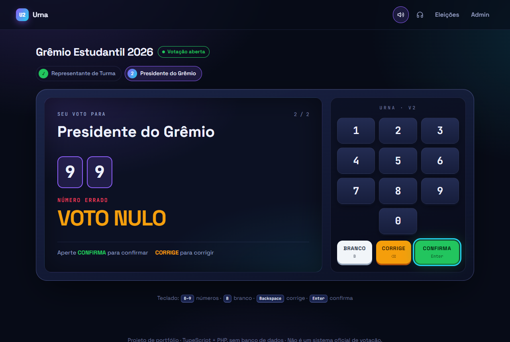
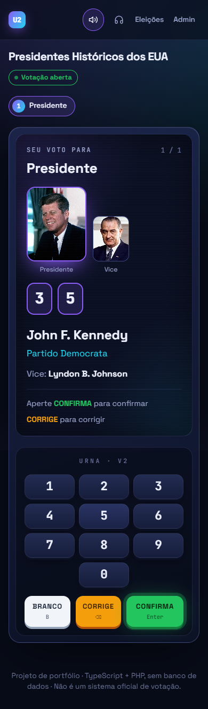
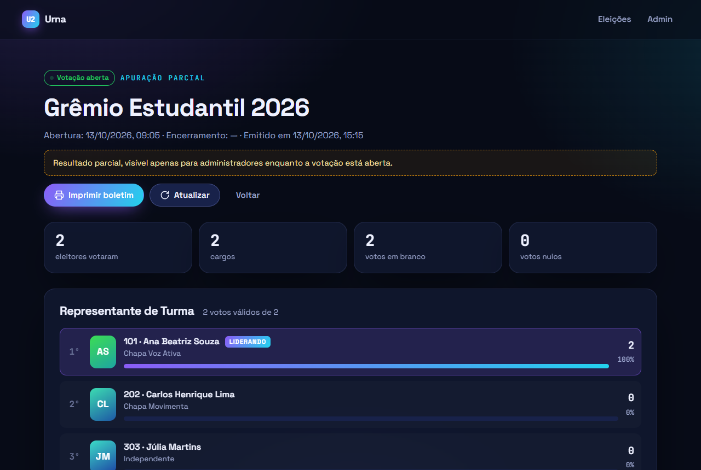
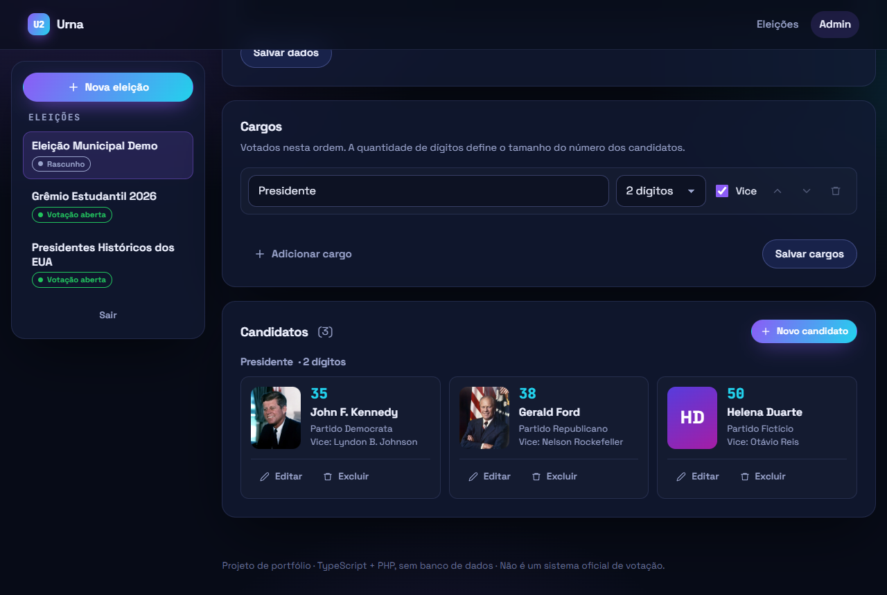
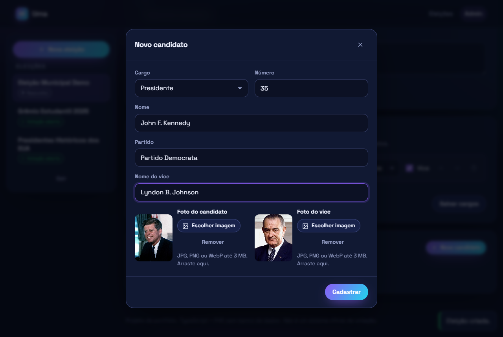
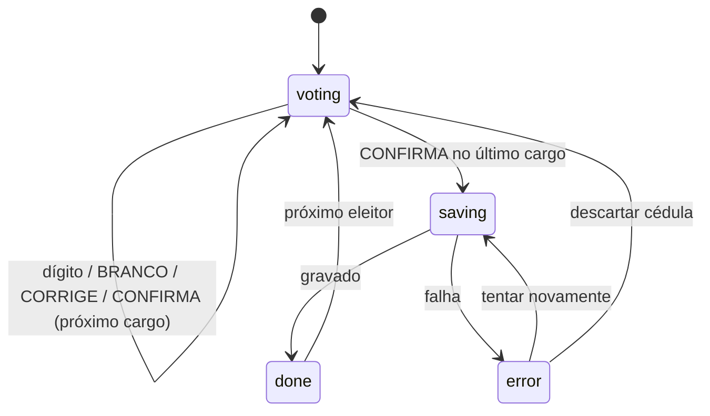

# Urna Eletrônica v2

Urna eletrônica completa para portfólio: cadastro de eleições, cargos e candidatos com foto, cabine de votação com teclado físico e modo áudio, e apuração com verificação de integridade. **Sem banco de dados**: cada eleição é um arquivo JSON.


| Voto nulo                                    | Celular                                 | Apuração                                       |
| -------------------------------------------- | --------------------------------------- | ---------------------------------------------- |
|  |  |  |

| Administração                                | Cadastro de candidato                             |
| -------------------------------------------- | ------------------------------------------------- |
|  |  |

## Funcionalidades

**Votação**

- Vários cargos em sequência, cada um com sua quantidade de dígitos (1 a 5) e vice opcional.
- Regras da urna real: BRANCO só com o visor vazio, CORRIGE limpa o cargo atual, número inexistente vira voto nulo.
- Teclado físico (`0–9`, `B`, `Backspace`, `Enter`), mouse e toque.
- Sons sintetizados com Web Audio, incluindo o "pi-pi-pi-piii" final.
- **Modo áudio**: lê a tela em voz alta com a Web Speech API (como o fone de ouvido da urna real), mais região `aria-live` para leitores de tela.
- Tela FIM com liberação automática para o próximo eleitor.
- Layout responsivo, sem rolagem horizontal no celular.

**Administração**

- Login de administrador (sessão PHP).
- Eleições: criar, editar, excluir; cargos com reordenação.
- Candidatos com foto do titular e do vice, com pré-visualização e arrastar-e-soltar.
- Ciclo de vida `rascunho → aberta → encerrada`. O cadastro fica congelado depois que a votação abre.

**Apuração**

- Resultado por cargo, com ranking, percentuais, brancos e nulos.
- Pública só depois do encerramento; o administrador vê a parcial.
- Boletim de urna para impressão (CSS de impressão).
- Verificação de integridade: os totais são recontados a partir do registro de cédulas, e o boletim traz um hash SHA-256.

## Stack

| Camada    | Tecnologias                                                                      |
| --------- | -------------------------------------------------------------------------------- |
| Front-end | TypeScript (strict), Vite, CSS puro, nenhum framework nem dependência de runtime |
| API       | PHP 8.2 sem frameworks nem Composer, GD para imagens                             |
| Dados     | Um arquivo JSON por eleição, com lock de arquivo e gravação atômica              |
| Qualidade | Vitest, testes da API em PHP puro, Prettier, GitHub Actions                      |

## Arquitetura

```
api/
  index.php            Front controller: rotas, CSRF, tratamento de erros
  src/
    Http/              Request, Router, HttpException
    Storage/JsonStore  Um JSON por chave, flock + rename atômico
    ElectionService    Eleições, cargos, candidatos e regras de ciclo de vida
    BallotService      Recebe cédulas, apura e verifica integridade
    PhotoStorage       Valida e regrava fotos como WebP 480×600
    Auth, Validator, Slug, Seeder
  tests/run.php        Testes da API
web/
  *.html               Páginas (início, votar, resultados, admin)
  src/booth/machine.ts Máquina de estados da cabine (pura, testada)
  src/pages/           Uma entrada por página
  src/lib/             Cliente da API, DOM, som, voz, formulários
storage/
  seed/                Eleições de exemplo (versionadas)
  elections/           Eleições em uso (ignorado pelo git)
uploads/               Fotos dos candidatos
```

### Máquina de estados da cabine

Toda a lógica da votação está em [`web/src/booth/machine.ts`](web/src/booth/machine.ts), uma função `reduce(estado, evento)` sem DOM. As transições são síncronas e independem das animações. Na versão anterior, um clique durante o fade da tela era avaliado contra o estado antigo, o que permitia gravar um voto nulo como válido. Esse tipo de bug não acontece mais.



### Arquivo de uma eleição

```jsonc
{
  "slug": "gremio-estudantil-2026",
  "title": "Grêmio Estudantil 2026",
  "status": "open", // draft | open | closed
  "offices": [{ "id": "presidente-do-gremio", "name": "Presidente do Grêmio", "digits": 2, "hasVice": true }],
  "candidates": [
    {
      "id": "a1c3e5b2d4f6",
      "officeId": "presidente-do-gremio",
      "number": "10",
      "name": "Marina Costa",
      "party": "Chapa Voz Ativa",
      "photo": "uploads/gremio-estudantil-2026/3f9c….webp",
      "vice": { "name": "Pedro Alves", "photo": null },
    },
  ],
  "ballots": 2,
  "tally": { "presidente-do-gremio": { "candidates": { "10": 1, "20": 0 }, "blank": 1, "null": 0 } },
  "rdv": [{ "presidente-do-gremio": "B" }, { "presidente-do-gremio": "10" }],
}
```

`rdv` (Registro Digital do Voto) guarda as cédulas **sem horário nem identificação**, cada uma inserida em uma posição aleatória, para que a ordem não revele quem votou em quem. Na apuração, os totais são recalculados a partir do `rdv`. Se não baterem com `tally`, o arquivo foi alterado fora da API e o boletim mostra "Inconsistência detectada".

### API

Todas as rotas que alteram dados exigem o cabeçalho `X-Requested-With: urna`, e as marcadas com 🔒 exigem login.

| Método   | Rota                                                                    | Descrição                                                      |
| -------- | ----------------------------------------------------------------------- | -------------------------------------------------------------- |
| `GET`    | `/api/auth`                                                             | Sessão atual                                                   |
| `POST`   | `/api/auth/login` · `/api/auth/logout`                                  | Entrar / sair                                                  |
| `GET`    | `/api/elections`                                                        | Lista resumida                                                 |
| `POST`   | `/api/elections` 🔒                                                     | Cria eleição                                                   |
| `GET`    | `/api/elections/{slug}`                                                 | Eleição com cargos e candidatos (sem votos)                    |
| `PATCH`  | `/api/elections/{slug}` 🔒                                              | Edita dados/cargos ou muda `status`                            |
| `DELETE` | `/api/elections/{slug}` 🔒                                              | Exclui eleição e fotos                                         |
| `POST`   | `/api/elections/{slug}/reset` 🔒                                        | Zera votos e volta a rascunho (demonstração)                   |
| `POST`   | `/api/elections/{slug}/candidates` 🔒                                   | Cadastra candidato                                             |
| `PATCH`  | `/api/elections/{slug}/candidates/{id}` 🔒                              | Edita candidato                                                |
| `DELETE` | `/api/elections/{slug}/candidates/{id}` 🔒                              | Exclui candidato                                               |
| `POST`   | `/api/elections/{slug}/candidates/{id}/photo?target=candidate\|vice` 🔒 | Envia foto (multipart, campo `photo`)                          |
| `DELETE` | `/api/elections/{slug}/candidates/{id}/photo?target=candidate\|vice` 🔒 | Remove foto                                                    |
| `POST`   | `/api/elections/{slug}/ballots`                                         | Registra uma cédula `{ "choices": { "cargo": "10" \| null } }` |
| `GET`    | `/api/elections/{slug}/results`                                         | Apuração (pública após o encerramento)                         |

Erros de validação voltam como `422 { "error": "...", "fields": { "campo": "mensagem" } }`, e o front-end mostra cada mensagem no campo correspondente.

## Decisões de segurança

- **O servidor decide o voto.** O cliente envia apenas o número digitado (ou `null` para branco). A API valida a quantidade de dígitos, exige todos os cargos e classifica como nulo o número que não pertence a nenhum candidato.
- **Concorrência.** Cada gravação faz ler, alterar e gravar sob `flock` exclusivo, com escrita em arquivo temporário seguida de `rename`. Dois votos simultâneos nunca se sobrescrevem.
- **Fotos.** O tipo é conferido pelo conteúdo (`finfo` + `getimagesize`), e a imagem é recortada e **regravada** como WebP com nome aleatório. Metadados (EXIF/GPS) e qualquer carga escondida no arquivo são descartados.
- **CSRF.** Cookie `SameSite=Strict` mais um cabeçalho customizado obrigatório, que formulários de outros sites não conseguem enviar.
- **XSS.** A interface nunca usa `innerHTML` com dados: o helper `h()` cria nós de texto.
- **Arquivos privados.** `.htaccess` (e o `server.php`) bloqueiam `storage/` e qualquer `.php` além do front controller. Em `uploads/`, a execução de PHP é desligada.

> Este é um projeto de estudo. Uma eleição real exige identificação do eleitor, auditoria independente, assinatura digital e muito mais.

## Como rodar

Requisitos: **PHP 8.2+** com `gd`, `fileinfo` e `mbstring`, e **Node 20+**.

### Com XAMPP (Apache)

```bash
# dentro de htdocs/urna
npm install
npm run build        # gera public/
```

Acesse <http://localhost/urna/>. As eleições de exemplo são criadas no primeiro acesso.

### Com o servidor embutido do PHP

```bash
npm install && npm run build
npm run serve        # php -S localhost:8000 server.php
```

Acesse <http://localhost:8000/>.

### Desenvolvimento (hot reload)

Com o PHP rodando (XAMPP ou `npm run serve`):

```bash
npm run dev                                       # usa http://localhost/urna como API
PHP_SERVER=http://localhost:8000 npm run dev      # se estiver usando php -S
```

O Vite repassa `/api` e `/uploads` para o PHP.

**Administração:** login e senha definidos em `api/config.php` (só o hash da senha fica no código). Para trocá-los, crie `api/config.local.php`:

```php
<?php
return [
    'admin_user' => 'novo-login',
    'admin_password_hash' => '$2y$10$...', // php -r "echo password_hash('nova', PASSWORD_DEFAULT);"
];
```

### Scripts

| Comando            | O que faz                              |
| ------------------ | -------------------------------------- |
| `npm run dev`      | Servidor de desenvolvimento            |
| `npm run build`    | Checagem de tipos e build em `public/` |
| `npm test`         | Testes da máquina de estados (Vitest)  |
| `npm run test:php` | Testes da API                          |
| `npm run lint`     | Prettier e TypeScript                  |
| `npm run seed`     | Restaura as eleições de exemplo        |

## Créditos

As eleições de exemplo (melhor banda de rock, jogo de video game e filme de terror) são só para diversão. Os nomes de bandas, jogos e filmes pertencem aos seus respectivos donos.

---

Desenvolvido por Sandro Jordão.
